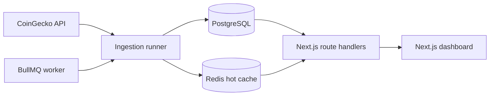

# SONITUS

SONITUS, kripto piyasası snapshot'larını arka planda toplayan, türetilmiş sinyalleri sunucu tarafında hesaplayan ve bunları Next.js dashboard'u ile sunan bir piyasa keşif aracıdır. Emir vermez, cüzdan bağlamaz ve yatırım tavsiyesi üretmez.

## Ürün kapsamı

Uygulama şu sorulara cevap verir:

- Hangi varlıkların hacim / piyasa değeri oranı yüksek?
- Hangi varlıklar 1 saat ve 24 saat pencerelerinde en sert hareketi gösteriyor?
- Hangi varlıkların 24 saatlik hacmi artıyor veya azalıyor?

Mevcut sürüm 24 saatlik spot hacme göre dinamik top 250 adayı tarar. İlk 250'den çıkan varlıklar sert hacim daralmalarını kaçırmamak için 48 saat daha izlenir. Dashboard ilk 25 filtrelenmiş sonucu gösterir ve kalanları isteğe bağlı olarak açar. Stablecoin'ler ile WETH/WBTC, liquid-staking receipt'leri ve benzeri ana varlığı tekrar eden türev temsiller koruyucu provider denylist'i ile ingestion öncesinde elenir; piyasa tablosuna, toplamlarına, sinyal panellerine ve detay API'lerine dahil edilmez. Dashboard ayrıca varlık detay sayfaları, URL tabanlı arama/filtreleme/sıralama, health paneli, okuma API'leri ve kimlik doğrulamalı manuel scan endpoint'i içerir.

## Gerçek mimari



- Web/API: Next.js 16, React 19, TypeScript, Tailwind CSS
- Veri katmanı: Prisma 6 ve PostgreSQL 16
- Queue/cache: BullMQ ve Redis 7
- Provider: CoinGecko; timeout, şema doğrulama, sınırlı eşzamanlılık ve exponential retry/backoff ile
- Loglama: JSON tabanlı Pino logları; token ve authorization alanları redakte edilir
- Dağıtım: web, worker ve migration için ayrı Docker target'ları; PostgreSQL, Redis ve Caddy ile tek VPS

Frontend dış veri sağlayıcısına doğrudan istek atmaz. Ingestion başarısız olduğunda son başarılı PostgreSQL/cache snapshot'ı korunur; production ortamında hata hiçbir zaman demo veriyle gizlenmez.

Ingestion, asset ve metric kayıtlarını toplu PostgreSQL işlemleriyle yazar. Redis/PostgreSQL dashboard snapshot'ı liste ekranında kullanılmayan sparkline verisini ve yinelenen panel kayıtlarını içermez; detay endpoint'i sparkline'ı tek asset için, koleksiyon API'leri ise geriye uyumluluk gerektiğinde tek toplu sorguyla hydrate eder.

## VPS'e yayınlama

Production topolojisi Caddy, Next.js web uygulaması, BullMQ worker, PostgreSQL, Redis,
migration ve backup container'larından oluşur. Yerel mock provası ve gerçek VPS
kurulumu için [deploy/README.md](deploy/README.md) rehberini izleyin.

## Sinyal hesapları

- `Vol/MCap`: `currentVolume / currentMarketCap`; sıfır piyasa değerinde güvenli biçimde `0` kabul edilir.
- Fiyat volatilitesi skoru: `|1h| × 2 + |24h|`; hacim sinyalinden bağımsızdır.
- `volumeDelta24h`: güncel hacim, yaklaşık 24 saat önceki en yakın metrikle karşılaştırılır. Tolerans varsayılan olarak 90 dakikadır. Yeterli tarihçe yoksa değer `null` olur ve `warming_up`, `missing` veya `stale` durumuyla açıklanır.
- Hacim sinyal skoru: `|volumeDelta24h| × log10(1 + max(currentVolume, baselineVolume) / 1_000_000)`.

Aynı `asset_id + captured_at` snapshot'ı unique constraint ve upsert ile idempotent işlenir. Metrikler varsayılan 30 günlük retention süresinden sonra temizlenir.

## Yerel geliştirme

Node.js 20.9 veya üzeri gerekir; CI ve Docker Node.js 22 kullanır.

```bash
cp .env.example .env
npm ci
npm run dev
```

`.env.example` varsayılan olarak `SONITUS_DATA_MODE=mock` kullanır. Bu mod yalnızca UI geliştirme ve hızlı yerel deneme içindir; PostgreSQL ya da worker gerektirmez. Ekran ve footer bunun demo veri olduğunu açıkça gösterir.

Kalite kapılarının tamamı:

```bash
npm run check
```

Bu komut lint, route type üretimi, strict TypeScript kontrolü, testler ve production build çalıştırır. Bağımlılık denetimi ayrıca şu komutla yapılır:

```bash
npm audit --omit=dev
```

PostgreSQL ve Redis hazırken ingestion persistence entegrasyonu ayrıca
`npm run test:integration` ile doğrulanabilir. Normal CI dış servislere bağlı bu
kontrolü çalıştırmaz; Prisma migration ve seed işlemlerini izole CI PostgreSQL'i
üzerinde doğrular.

## Docker ile çalıştırma

- Tek tek Docker Compose komutlarını yazmamak için:

  ```bash
  ./deploy/docker-mock.sh up
  ./deploy/docker-mock.sh logs
  ./deploy/docker-mock.sh down
  ```

  Canlı ortamda aynı işlemler `./deploy/docker-production.sh deploy`,
  `./deploy/docker-production.sh logs` ve
  `./deploy/docker-production.sh ps` ile yapılabilir. Tüm kısa komutları görmek
  için ilgili script'i parametresiz çalıştırın.

  VDS'te yeni kodu aldıktan sonra tüm güncelleme adımlarını tek komutla
  çalıştırabilirsiniz:

  ```bash
  git pull --ff-only
  ./deploy/vds-update.sh
  ```

  Script `deploy/.env.production` dosyasını otomatik kullanır; `--env-file` ve
  Compose dosyası parametrelerini ayrıca yazmanız gerekmez.

- Sahte snapshot ile tüm VPS topolojisini yerelde denemek için
  `docker compose -f deploy/compose.mock.yml up --build -d` kullanın. Bu yol env
  dosyası istemez, worker çalıştırmaz ve dış sağlayıcıya istek atmaz.
- Gerçek production için `deploy/.env.production.example` dosyasını
  `deploy/.env.production` olarak kopyalayın ve `deploy/README.md` içindeki
  `--env-file` komutlarını kullanın.

Kökteki `.env` yalnızca host üzerinde yerel geliştirme içindir ve production
servis adresleri içermemelidir. VDS secret'ları yalnızca Git'e alınmayan
`deploy/.env.production` dosyasında tutulur. `npm run db:seed` hedef
veritabanını temizlediği için varsayılan olarak yalnızca loopback adreslerinde
çalışır. İzole bir uzak test veritabanını bilinçli olarak sıfırlamak için komuta
ayrıca `ALLOW_DESTRUCTIVE_SEED=true` verilmesi gerekir; production ortamında bu
değişken kullanılmamalıdır.

## Ortam değişkenleri

| Değişken | Zorunluluk | Açıklama |
| --- | --- | --- |
| `SONITUS_DATA_MODE` | Evet | `mock` veya `database`; production varsayılanı `database` |
| `DATABASE_URL` | Database modunda | PostgreSQL bağlantısı |
| `REDIS_URL` | Production/worker | BullMQ ingestion ve dashboard hot cache bağlantısı |
| `INTERNAL_JOB_TOKEN` | Ingestion/manual scan için | Production'da en az 32 karakter; yalnızca header ile gönderilir |
| `SCAN_INTERVAL_MINUTES` | Hayır | Docker/BullMQ worker aralığı; varsayılan `5` |
| `SCAN_STALE_MINUTES` | Hayır | Health ve UI stale eşiği; varsayılan `15` |
| `SCAN_LOCK_SECONDS` | Hayır | Çakışan ingestion'ları engelleyen Redis lock TTL; varsayılan `1200` |
| `METRIC_RETENTION_DAYS` | Hayır | Varsayılan `30` |
| `VOLUME_BASELINE_TOLERANCE_MINUTES` | Hayır | 24 saatlik baseline toleransı; varsayılan `90` |
| `CANDIDATE_RETENTION_HOURS` | Hayır | Hacim aday listesinden çıkan varlığın takip süresi; varsayılan `48` |
| `MIN_MARKET_CAP_USD` | Hayır | Aday ve görünür sinyal evreni için minimum market cap; varsayılan `50000000` |
| `MIN_VOLUME_USD` | Hayır | Güncel veya baseline için minimum hacim; varsayılan `10000000` |
| `CACHE_TTL_SECONDS` | Hayır | Redis dashboard cache TTL; varsayılan `900` |
| `COINGECKO_SCAN_LIMIT` | Hayır | Spot 24 saatlik hacme göre dinamik aday sayısı; en fazla ve varsayılan `250` |
| `COINGECKO_CONCURRENCY` | Hayır | Coin detay istek eşzamanlılığı; varsayılan `4` |
| `COINGECKO_TIMEOUT_MS` | Hayır | İstek timeout; varsayılan `10000` |
| `COINGECKO_MAX_RETRIES` | Hayır | 429/5xx/network retry sayısı; varsayılan `3` |
| `COINGECKO_API_MODE` | Production'da | Yerelde `public`; production'da keyed `demo` veya `pro` |
| `COINGECKO_API_KEY` | Production'da | CoinGecko Demo/Pro anahtarı |
| `COINGECKO_BASE_URL` | Hayır | Boş bırakılırsa moda göre Demo/Public veya Pro hostu seçilir |
| `LOG_LEVEL` | Hayır | Production varsayılanı `info` |

## API

Okuma endpoint'leri:

- `GET /api/dashboard`
- `GET /api/assets`
- `GET /api/assets/:id`
- `GET /api/scans/latest`
- `GET /api/health`

Dashboard ve asset listesi `query`, `sort`, `minMarketCap`, `minVolume` parametrelerini kabul eder. Geçersiz API parametreleri `400`, veri katmanı kullanılamıyorsa `503` döner. Market cevapları kısa CDN cache başlıkları taşır; health ve hata cevapları cache'lenmez.

Manuel tarama BullMQ'ya iş gönderir ve `202 Accepted` döner:

```bash
curl -X POST http://localhost:3000/internal/jobs/scan-now \
  -H "Authorization: Bearer $INTERNAL_JOB_TOKEN"
```

Token query string ile kabul edilmez. Kısa süre içindeki tekrar manuel istekler queue deduplication ile sınırlandırılır.

## Migration ve veri yaşam döngüsü

Production deploy sırasında uygulama process'inden ayrı bir release/migration adımı çalıştırın:

```bash
npm run db:deploy
```

`prisma migrate dev` yalnızca geliştirme içindir. Seed komutu demo snapshot yazar ve mevcut tabloları temizleyebildiği için production veritabanında çalıştırılmamalıdır.

BullMQ Job Scheduler tek bir periyodik schedule kaydı kullanır. Sağlayıcı hatası `scan_jobs` tablosuna `failed` olarak yazılır, başarılı son cache korunur ve snapshot yazımı idempotenttir.

Başarılı ingestion logları `providerMs`, `databaseMs`, `cacheMs`, `persistenceMs`, `totalMs` ve `cacheBytes` alanlarını içerir.

## Production çıkış kontrolü

Kod tabanı production dağıtımına hazır kalite kapılarını içerir; gerçek ortamın hazır sayılması için operatörün şu maddeleri tamamlaması gerekir:

- PostgreSQL yedeklerini VPS dışında da saklamak ve düzenli restore provası yapmak.
- Güçlü `INTERNAL_JOB_TOKEN` ve keyed CoinGecko Demo/Pro anahtarını secret manager üzerinden vermek.
- Migration target'ını deploy öncesi çalıştırmak ve web/worker servislerinin health durumunu doğrulamak.
- `/api/health` için readiness alarmı, worker failed/stale alarmı ve merkezi Pino log toplama kurmak.
- Kullanılan CoinGecko planının scan limit/concurrency ayarlarını karşıladığını yük testiyle doğrulamak.
- Dış erişimde TLS, WAF/rate limit ve platform seviyesinde DDoS koruması kullanmak.

Sentry ve OpenTelemetry bu repository'de yapılandırılmış değildir; merkezi hata izleme veya dağıtık tracing isteniyorsa deploy platformuna göre eklenmelidir. Bu dış operasyon maddeleri tamamlanmadan herhangi bir servis için koşulsuz “production hazır” beyanı doğru olmaz.
