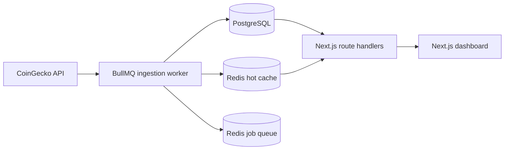

# SONITUS

SONITUS, kripto piyasası snapshot'larını arka planda toplayan, türetilmiş sinyalleri sunucu tarafında hesaplayan ve bunları Next.js dashboard'u ile sunan bir piyasa keşif aracıdır. Emir vermez, cüzdan bağlamaz ve yatırım tavsiyesi üretmez.

## Ürün kapsamı

Uygulama şu sorulara cevap verir:

- Hangi varlıkların hacim / piyasa değeri oranı yüksek?
- Hangi varlıklar 1 saat ve 24 saat pencerelerinde en sert hareketi gösteriyor?
- Hangi varlıkların 24 saatlik hacmi artıyor veya azalıyor?
- Takip edilen varlıkların kategorilerinde piyasa değeri baskısı hangi yönde?

Mevcut sürümde dashboard, varlık ve kategori detay sayfaları, URL tabanlı arama/filtreleme/sıralama, health paneli, okuma API'leri ve kimlik doğrulamalı manuel scan endpoint'i bulunur.

## Gerçek mimari



- Web/API: Next.js 16, React 19, TypeScript, Tailwind CSS
- Veri katmanı: Prisma 6 ve PostgreSQL 16
- Queue/cache: BullMQ ve Redis 7
- Provider: CoinGecko; timeout, şema doğrulama, sınırlı eşzamanlılık ve exponential retry/backoff ile
- Loglama: JSON tabanlı Pino logları; token ve authorization alanları redakte edilir
- Dağıtım: web, worker ve migration için ayrı Docker target'ları

Frontend dış veri sağlayıcısına doğrudan istek atmaz. Worker başarısız olduğunda son başarılı PostgreSQL/cache snapshot'ı korunur; production ortamında hata hiçbir zaman demo veriyle gizlenmez.

## Sinyal hesapları

- `Vol/MCap`: `currentVolume / currentMarketCap`; sıfır piyasa değerinde güvenli biçimde `0` kabul edilir.
- Volatilite skoru: `|1h| × 1.35 + |24h| × 0.95 + |volumeDelta24h| × 0.18`.
- `volumeDelta24h`: güncel hacim, yaklaşık 24 saat önceki en yakın metrikle karşılaştırılır. Tolerans varsayılan olarak 90 dakikadır. Yeterli tarihçe yoksa değer `0` olur; ilk günden önce gerçek 24 saatlik delta üretilemez.
- Kategori gücü: CoinGecko kategori market-cap değişimi. Yalnızca taranan varlıkların kullanılan kategorileri saklanır ve gösterilir.

Aynı `asset_id + captured_at` snapshot'ı unique constraint ve upsert ile idempotent işlenir. Metrikler varsayılan 30 günlük retention süresinden sonra temizlenir.

## Yerel geliştirme

Node.js 20.9 veya üzeri gerekir; CI ve Docker Node.js 22 kullanır.

```bash
cp .env.example .env
npm ci
npm run dev
```

`.env.example` varsayılan olarak `SONITUS_DATA_MODE=mock` kullanır. Bu mod yalnızca UI geliştirme ve hızlı yerel deneme içindir; PostgreSQL ya da worker gerektirmez. Ekran ve footer bunun demo veri olduğunu açıkça gösterir.

Kalite kapılarının tamamı:

```bash
npm run check
```

Bu komut lint, route type üretimi, strict TypeScript kontrolü, testler ve production build çalıştırır. Bağımlılık denetimi ayrıca şu komutla yapılır:

```bash
npm audit --omit=dev
```

## Tam stack'i Docker ile çalıştırma

En az 32 karakterlik benzersiz bir internal token belirleyin:

```bash
cp .env.example .env
# .env içinde INTERNAL_JOB_TOKEN ve gerekiyorsa CoinGecko ayarlarını değiştirin
docker compose up --build
```

Compose sırasıyla PostgreSQL/Redis'i hazırlar, migration'ları uygular ve web ile worker servislerini başlatır. Dashboard `http://localhost:3000`, readiness endpoint'i `http://localhost:3000/api/health` adresindedir.

Veritabanını yerel servislerle fakat uygulamayı host üzerinde çalıştırmak için:

```bash
docker compose up -d postgres redis
SONITUS_DATA_MODE=database npm run db:deploy
SONITUS_DATA_MODE=database npm run db:seed
SONITUS_DATA_MODE=database npm run dev
```

Worker ayrı process olarak çalıştırılır:

```bash
SONITUS_DATA_MODE=database npm run worker:scan
```

## Ortam değişkenleri

| Değişken | Zorunluluk | Açıklama |
| --- | --- | --- |
| `SONITUS_DATA_MODE` | Evet | `mock` veya `database`; production varsayılanı `database` |
| `DATABASE_URL` | Database modunda | PostgreSQL bağlantısı |
| `REDIS_URL` | Production/worker | BullMQ ve dashboard hot cache bağlantısı |
| `INTERNAL_JOB_TOKEN` | Manuel scan için | Production'da en az 32 karakter; yalnızca header ile gönderilir |
| `SCAN_INTERVAL_MINUTES` | Hayır | Varsayılan `5` |
| `SCAN_STALE_MINUTES` | Hayır | Health ve UI stale eşiği; varsayılan `15` |
| `METRIC_RETENTION_DAYS` | Hayır | Varsayılan `30` |
| `VOLUME_BASELINE_TOLERANCE_MINUTES` | Hayır | 24 saatlik baseline toleransı; varsayılan `90` |
| `CACHE_TTL_SECONDS` | Hayır | Redis dashboard cache TTL; varsayılan `900` |
| `COINGECKO_SCAN_LIMIT` | Hayır | Taranan top varlık sayısı; varsayılan `25` |
| `COINGECKO_CONCURRENCY` | Hayır | Coin detay istek eşzamanlılığı; varsayılan `4` |
| `COINGECKO_TIMEOUT_MS` | Hayır | İstek timeout; varsayılan `10000` |
| `COINGECKO_MAX_RETRIES` | Hayır | 429/5xx/network retry sayısı; varsayılan `3` |
| `COINGECKO_API_MODE` | Hayır | `public`, `demo` veya `pro` |
| `COINGECKO_API_KEY` | Plan gerektiriyorsa | CoinGecko anahtarı |
| `COINGECKO_BASE_URL` | Hayır | Varsayılan `https://api.coingecko.com/api/v3` |
| `LOG_LEVEL` | Hayır | Production varsayılanı `info` |

## API

Okuma endpoint'leri:

- `GET /api/dashboard`
- `GET /api/assets`
- `GET /api/assets/:id`
- `GET /api/categories`
- `GET /api/scans/latest`
- `GET /api/health`

Dashboard ve asset listesi `query`, `category`, `sort`, `minMarketCap`, `minVolume` parametrelerini kabul eder. Geçersiz API parametreleri `400`, veri katmanı kullanılamıyorsa `503` döner. Market cevapları kısa CDN cache başlıkları taşır; health ve hata cevapları cache'lenmez.

Manuel tarama gerçek bir BullMQ işi kuyruğa ekler ve `202 Accepted` döner:

```bash
curl -X POST http://localhost:3000/internal/jobs/scan-now \
  -H "Authorization: Bearer $INTERNAL_JOB_TOKEN"
```

Token query string ile kabul edilmez. Kısa süre içindeki tekrar manuel istekler queue deduplication ile sınırlandırılır.

## Migration ve veri yaşam döngüsü

Production deploy sırasında uygulama process'inden ayrı bir release/migration adımı çalıştırın:

```bash
npm run db:deploy
```

`prisma migrate dev` yalnızca geliştirme içindir. Seed komutu demo snapshot yazar ve mevcut tabloları temizleyebildiği için production veritabanında çalıştırılmamalıdır.

BullMQ Job Scheduler tek bir periyodik schedule kaydı kullanır. Job'lar üç deneme ve exponential backoff ile çalışır; sağlayıcı hatası `scan_jobs` tablosuna `failed` olarak yazılır, başarılı son cache korunur.

## Production çıkış kontrolü

Kod tabanı production dağıtımına hazır kalite kapılarını içerir; gerçek ortamın hazır sayılması için operatörün şu maddeleri tamamlaması gerekir:

- Managed PostgreSQL ve Redis'i yedekleme, TLS ve erişim politikalarıyla sağlamak.
- Güçlü `INTERNAL_JOB_TOKEN` ve gerekiyorsa CoinGecko anahtarını secret manager üzerinden vermek.
- Migration target'ını deploy öncesi tek sefer çalıştırmak; web ve worker'ı ayrı servis olarak dağıtmak.
- `/api/health` için readiness alarmı, worker failed/stale alarmı ve merkezi Pino log toplama kurmak.
- Kullanılan CoinGecko planının scan limit/concurrency ayarlarını karşıladığını yük testiyle doğrulamak.
- Dış erişimde TLS, WAF/rate limit ve platform seviyesinde DDoS koruması kullanmak.

Sentry ve OpenTelemetry bu repository'de yapılandırılmış değildir; merkezi hata izleme veya dağıtık tracing isteniyorsa deploy platformuna göre eklenmelidir. Bu dış operasyon maddeleri tamamlanmadan herhangi bir servis için koşulsuz “production hazır” beyanı doğru olmaz.
