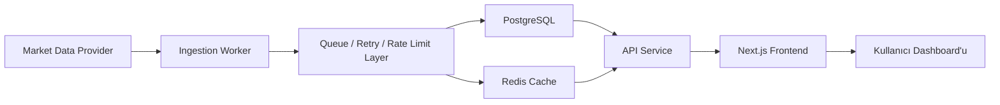

# SONITUS Proje Taslağı

SONITUS, kripto piyasasını sürekli tarayan, veriyi sunucu tarafında işleyen ve kullanıcıya analitik bir dashboard olarak sunan bir crypto screener ürünüdür. Bu doküman, projeyi sıfırdan geliştirecek ekip için kapsam, mimari, stack, veri akışı ve uygulama planını tanımlar.

Amaç sadece bir fiyat listesi göstermek değil; hacim, volatilite, piyasa değeri değişimi ve kategori gücü gibi sinyalleri bir araya getirerek piyasayı okunabilir hale getirmektir.

## 1. Ürünün Tanımı

SONITUS bir veri görüntüleme uygulamasından çok, veri işleme ve sinyal üretme ürünüdür. Sistem aşağıdaki sorulara cevap verir:

1. Hangi varlıklar piyasaya göre anormal derecede yüksek işlem hacmi üretiyor?
2. Hangi varlıklar kısa vadede en sert fiyat hareketini gösteriyor?
3. Hangi varlıkların 24 saatlik hacmi düşüyor veya artıyor?
4. Hangi kripto kategorileri piyasa değeri bazında güç kazanıyor veya kaybediyor?

Bu ürün bir trade bot değildir, emir yönetmez, cüzdan bağlamaz ve yatırım tavsiyesi vermez. Bir keşif ve analiz aracıdır.

## 2. Projenin Amacı

Bu ürünün temel amacı, kripto piyasa verisini tek bir ekranda anlamlı sinyallere dönüştürmektir. Bunu yaparken üç hedef öne çıkar:

1. Ham veriyi değil, işlenmiş sonucu göstermek.
2. Dış veri sağlayıcılarına sürekli bağımlı bir tarayıcı mimarisinden kaçınmak.
3. Ölçeklenebilir, bakımı kolay ve modern bir web uygulaması kurmak.

Bu yüzden sistem, veri toplama, veri işleme, önbellekleme, API sunumu ve arayüz katmanlarını birbirinden ayırır.

## 3. Önerilen Modern Stack

Bu proje için en dengeli ve modern stack aşağıdaki gibidir.

### Frontend

1. Next.js 15
2. React 19
3. TypeScript
4. Tailwind CSS
5. shadcn/ui
6. TanStack Query
7. Zod
8. Recharts veya Tremor

### Backend

1. Node.js 20+
2. Fastify veya NestJS
3. TypeScript
4. Prisma
5. PostgreSQL
6. Redis
7. BullMQ

### Worker ve Planlı İşler

1. Ayrı bir worker servisi
2. Cron tabanlı job scheduler
3. Queue tabanlı batch processing

### Gözlemleme ve Operasyon

1. Sentry
2. OpenTelemetry
3. pino logs
4. Docker

### Deployment

1. Frontend için Vercel veya Cloudflare Pages
2. API ve worker için Render, Fly.io veya AWS ECS
3. PostgreSQL için Neon, Supabase veya RDS
4. Redis için Upstash veya managed Redis

## 4. Neden Bu Stack?

Bu proje için en kritik ihtiyaçlar hızlı UI, sağlam veri akışı ve güvenilir tarama işidir. Bu yüzden stack seçimi şu kriterlere göre yapılır:

1. React ve Next.js, dashboard tipi ekranlar için en verimli geliştirme deneyimini sağlar.
2. TypeScript, veri yoğun ekranlarda tip güvenliği sağlar.
3. PostgreSQL, tarihsel veri ve zaman serisi benzeri kayıtlar için uygundur.
4. Redis + BullMQ, tarama işlerini kuyruklayıp kontrollü şekilde çalıştırmayı sağlar.
5. Worker ayrımı, frontend ile veri toplama sürecini birbirinden ayırır.

Netlify bu mimaride zorunlu değildir. İsterseniz yalnızca hosting katmanında kullanılabilir, ama iş mantığı Netlify'a bağlı olmamalıdır.

## 5. Yüksek Seviye Mimari



### Mimari Katmanları

1. Veri sağlayıcıları: CoinGecko, CoinMarketCap veya başka bir market data API.
2. Ingestion worker: piyasa verisini düzenli olarak çeken servis.
3. Queue layer: batch işlemleri, retry ve backoff yönetimi.
4. Database: tarihsel ve güncel verinin saklandığı ana depo.
5. Cache: dashboard için hızlı okuma katmanı.
6. API: frontend'in kullandığı tek okuma kapısı.
7. Frontend: filtreler, tablolar, trend panelleri ve grafikler.

## 6. Proje Kapsamı

### MVP'de Olacaklar

1. Top market cap varlıkların listelenmesi
2. 1 saat ve 24 saat fiyat değişimi
3. Market cap ve volume oranı hesapları
4. Gerçek 24 saatlik hacim değişimi
5. Kategori performans ekranı
6. Sıralama, filtreleme ve arama
7. Otomatik veri güncelleme

### MVP'de Olmayacaklar

1. Emir verme
2. Cüzdan entegrasyonu
3. Kişisel portföy takibi
4. Sosyal feed
5. Trading bot
6. Canlı grafik işlem platformu

## 7. Veri Akışı

Sistem şu sırayla çalışır:

1. Worker, market data sağlayıcısından coin listesini çeker.
2. Coin bazlı detaylar küçük batch'ler halinde işlenir.
3. Hacim değişimi gibi türetilmiş alanlar hesaplanır.
4. Sonuçlar PostgreSQL'e yazılır.
5. Sık kullanılan özetler Redis'te cache'lenir.
6. API, frontend'e tek ve tutarlı bir dashboard payload'ı döner.
7. Next.js frontend bu payload'ı render eder.

### Batch Mantığı

Kripto veri sağlayıcıları rate limit uygular. Bu nedenle sistem tüm coin'leri aynı anda taramak yerine küçük gruplar halinde işler. Önerilen yöntem:

1. Varlıkları market cap'e göre sırala.
2. 10-20 varlıklı batch'lere böl.
3. Her batch arasında backoff ve retry uygula.
4. Başarısız coin'leri bir sonraki turda tekrar dene.
5. Sonuçları idempotent şekilde kaydet.

## 8. Veri Modeli

### Önerilen Tablolar

#### assets

Kripto varlıkların temel bilgileri.

Alanlar:

1. id
2. provider_id
3. symbol
4. name
5. image_url
6. current_market_cap
7. current_volume
8. last_price
9. created_at
10. updated_at

#### asset_metrics

Zaman damgalı piyasa snapshot'ları.

Alanlar:

1. id
2. asset_id
3. captured_at
4. price
5. market_cap
6. volume_24h
7. change_1h
8. change_24h
9. volume_delta_24h

#### categories

Kategori tanımları.

Alanlar:

1. id
2. provider_id
3. name
4. market_cap_change_24h
5. created_at
6. updated_at

#### scan_jobs

Tarama işlerinin sağlık ve durum takibi.

Alanlar:

1. id
2. job_type
3. status
4. started_at
5. finished_at
6. processed_count
7. error_message

#### cache_snapshots

Dashboard için hazırlanmış hızlı okunabilir snapshot'lar.

Alanlar:

1. id
2. snapshot_type
3. payload
4. refreshed_at

## 9. API Tasarımı

API yalnızca veri okuma için kullanılmalıdır. Yazma işlemleri worker tarafından yapılır.

### Önerilen Endpoint'ler

1. `GET /api/dashboard`
2. `GET /api/assets`
3. `GET /api/assets/:id`
4. `GET /api/categories`
5. `GET /api/scans/latest`
6. `POST /internal/jobs/scan-now`

### Dashboard Payload Örneği

```json
{
  "ok": true,
  "updatedAt": "2026-07-08T12:00:00Z",
  "coins": [],
  "categories": [],
  "highVolMcap": [],
  "volatileAssets": [],
  "fallingVolume": []
}
```

## 10. Frontend Yapısı

Frontend tarafı Next.js App Router ile kurulmalıdır.

### Önerilen Sayfalar

1. Ana dashboard
2. Coin detay sayfası
3. Kategori detay sayfası
4. Gelişmiş filtreler sayfası
5. Sistem durumu / health paneli

### Önerilen Bileşenler

1. FilterBar
2. MetricCards
3. AssetsTable
4. VolatilityPanel
5. CategoryRanking
6. VolumeDropPanel
7. UpdateStatusBadge
8. EmptyState

### UI Prensipleri

1. Yoğun veri, okunabilir tipografi ile sunulmalı.
2. Tablo ve kartlar birlikte kullanılmalı.
3. Filtreler görünür ve kalıcı olmalı.
4. Mobilde ana metrikler önceliklendirilmelidir.
5. Loading ve empty state davranışları net olmalıdır.

## 11. İş Mantığı

Sistemin ana değerini üreten hesaplar frontend'de değil backend'de yapılmalıdır.

### Hesaplanacak Metikler

1. Vol/MCap oranı
2. Volatilite skoru
3. Hacim değişimi yüzdesi
4. Kategori büyüme skoru
5. Piyasa değeri filtreleri

### Kurallar

1. Hesaplar idempotent olmalıdır.
2. Aynı veri birden fazla kez işlenirse sonuç değişmemelidir.
3. Eksik veri durumunda uygulama bozulmamalı, sadece ilgili satır boş görünmelidir.
4. API'den gelen veriler Zod ile doğrulanmalıdır.

## 12. Cron ve Worker Tasarımı

Bu projede gerçek zamanlılık yerine kontrollü güncellik tercih edilmelidir.

### Job Tipleri

1. Market snapshot job
2. Categories refresh job
3. Volume history batch job
4. Cleanup job
5. Retry job

### Tarama Stratejisi

1. Her 1-5 dakikada bir ana market snapshot alın.
2. Hacim geçmişini parça parça güncelle.
3. Hata alan coin'leri retry queue'ya at.
4. İş başarıyla tamamlanınca cache snapshot'ı yenile.

Bu yapı, tek bir uzun cron yerine kontrollü ve gözlemlenebilir bir iş akışı sağlar.

## 13. Güvenlik ve Dayanıklılık

1. API anahtarları env var olarak saklanmalı.
2. Internal job endpoint'leri kimlik doğrulama ile korunmalı.
3. Rate limit backoff uygulanmalı.
4. Provider hata verdiğinde sistem degrade modda çalışmalı.
5. Loglar kişisel veri içermemeli.

## 14. Performans Hedefleri

1. Dashboard ilk yükleme süresi kısa olmalı.
2. Snapshot API yanıtı hızlı olmalı.
3. Tarama işleri kullanıcı trafiğinden bağımsız çalışmalı.
4. UI filtreleri büyük veri setinde dahi akıcı kalmalı.

Önerilen limitler:

1. Dashboard API yanıtı: 200 ms altı hedef
2. Snapshot yenileme: 30-60 saniye arası
3. Worker batch süresi: provider limitine göre ayarlanmalı

## 15. Geliştirme Sırası

Bu projeyi sıfırdan inşa edecek ekip için en doğru sıra aşağıdadır:

### Faz 1: Temel İskelet

1. Next.js projesi oluştur
2. TypeScript ve Tailwind kur
3. UI kit'i entegre et
4. Ana dashboard sayfasını oluştur

### Faz 2: Veri Katmanı

1. PostgreSQL şemasını kur
2. Prisma modellerini yaz
3. İlk dashboard API'sini oluştur
4. Cache mekanizmasını ekle

### Faz 3: Worker ve Tarama

1. Provider entegrasyonunu yaz
2. Batch scan mantığını kur
3. Retry/backoff ekle
4. Snapshot üretimini tamamla

### Faz 4: Görselleştirme

1. Tablo bileşenlerini oluştur
2. Filtre ve aramayı ekle
3. Volatilite ve kategori panellerini kur
4. Mobile responsive düzeni tamamla

### Faz 5: Operasyon

1. Loglama ve hata izleme ekle
2. Job health paneli oluştur
3. Deployment pipeline kur
4. Load test ve API sınırlarını doğrula

## 16. Deployment Önerisi

Bu proje için deployment, mimarinin doğal uzantısı olmalıdır.

### Önerilen Kurulum

1. Frontend: Vercel
2. API: Render veya Fly.io
3. Worker: Render background worker veya ayrı container
4. Database: Neon veya Supabase
5. Cache: Upstash Redis

### Alternatif

Eğer ekip tek sağlayıcıyla ilerlemek istiyorsa, monorepo içinde frontend + API + worker ayrı servisler olarak da yönetilebilir.

## 17. Netlify Bu Taslakta Nereye Oturur?

Netlify zorunlu değildir. Bu taslakta Netlify sadece opsiyonel hosting katmanıdır.

Netlify kullanılırsa:

1. Statik frontend yayınlanabilir.
2. Basit serverless endpoint'ler oluşturulabilir.
3. Ancak ciddi tarama ve veri işleme için ayrı worker yine daha doğru olur.

Yani Netlify, ana mimari değil; opsiyonel dağıtım aracıdır.

## 18. Başarı Kriterleri

Birinci sürüm başarılı sayılmak için şunları sağlamalıdır:

1. Dashboard verisi düzenli ve güvenilir biçimde yenilenmeli.
2. Kullanıcı veri kaynağına doğrudan bağımlı hissetmemeli.
3. Filtreler ve sıralamalar büyük veri setinde çalışmalı.
4. Worker süreçleri hata alsa bile sistem tamamen çökmemeli.
5. Kod tabanı yeni veri sağlayıcısına geçişe uygun olmalı.

## 19. Sonuç

SONITUS için doğru yaklaşım, modern bir React tabanlı dashboard ile sağlam bir backend ingestion katmanını birbirinden ayırmaktır. En iyi sonuç, frontend tarafında Next.js + React + TypeScript, backend tarafında Node.js + PostgreSQL + Redis + worker queue mimarisi ile alınır.

Bu doküman, ekiplerin projeyi sıfırdan kurabilmesi için ürün hedefini, teknik sınırlarını ve uygulanacak mimariyi netleştiren başlangıç taslağıdır.
