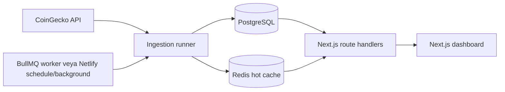

# SONITUS

SONITUS, kripto piyasası snapshot'larını arka planda toplayan, türetilmiş sinyalleri sunucu tarafında hesaplayan ve bunları Next.js dashboard'u ile sunan bir piyasa keşif aracıdır. Emir vermez, cüzdan bağlamaz ve yatırım tavsiyesi üretmez.

## Ürün kapsamı

Uygulama şu sorulara cevap verir:

- Hangi varlıkların hacim / piyasa değeri oranı yüksek?
- Hangi varlıklar 1 saat ve 24 saat pencerelerinde en sert hareketi gösteriyor?
- Hangi varlıkların 24 saatlik hacmi artıyor veya azalıyor?

Mevcut sürüm 24 saatlik spot hacme göre dinamik top 250 adayı tarar. İlk 250'den çıkan varlıklar sert hacim daralmalarını kaçırmamak için 48 saat daha izlenir. Dashboard ilk 25 filtrelenmiş sonucu gösterir ve kalanları isteğe bağlı olarak açar. Stablecoin'ler koruyucu provider denylist'i ile ingestion öncesinde elenir; piyasa tablosuna, toplamlarına, sinyal panellerine ve detay API'lerine dahil edilmez. Dashboard ayrıca varlık detay sayfaları, URL tabanlı arama/filtreleme/sıralama, health paneli, okuma API'leri ve kimlik doğrulamalı manuel scan endpoint'i içerir.

## Gerçek mimari



- Web/API: Next.js 16, React 19, TypeScript, Tailwind CSS
- Veri katmanı: Prisma 6 ve PostgreSQL 16
- Queue/cache: BullMQ ve Redis 7
- Provider: CoinGecko; timeout, şema doğrulama, sınırlı eşzamanlılık ve exponential retry/backoff ile
- Loglama: JSON tabanlı Pino logları; token ve authorization alanları redakte edilir
- Dağıtım: web, worker ve migration için ayrı Docker target'ları; Netlify için Scheduled + Background Functions

Frontend dış veri sağlayıcısına doğrudan istek atmaz. Ingestion başarısız olduğunda son başarılı PostgreSQL/cache snapshot'ı korunur; production ortamında hata hiçbir zaman demo veriyle gizlenmez.

## Netlify'a yayınlama

Netlify, Next.js web/API katmanını OpenNext adaptörüyle çalıştırır. Bu repository ayrıca Netlify üzerinde her 10 dakikada tetiklenen Scheduled Function ve ağır ingestion işini en fazla 15 dakika çalışabilen Background Function içerir. Bu nedenle Netlify deploy'unda ayrı bir BullMQ worker servisi zorunlu değildir; Docker/Render/Fly dağıtımlarında BullMQ worker kullanılmaya devam eder.

Bu uygulama statik bir site değildir. Netlify Drop'a `.next` klasörünü sürüklemek yerine repository'yi Git sağlayıcısından bağlayın veya Netlify CLI kullanın. Build ayarları [netlify.toml](netlify.toml) içindedir.

İlk deploy öncesinde:

1. Managed PostgreSQL ve Redis oluşturun. Serverless web trafiği için PostgreSQL sağlayıcınızın pooled connection URL'ini tercih edin.
2. Production veritabanında `DATABASE_URL="..." npm run db:deploy` çalıştırın. Production'da `db:seed` çalıştırmayın.
3. Netlify Project configuration → Environment variables bölümüne aşağıdaki değişkenleri ekleyin; scope kullanıyorsanız Functions scope'unu dahil edin:
   - `SONITUS_DATA_MODE=database`
   - `DATABASE_URL`
   - `REDIS_URL`
   - `INTERNAL_JOB_TOKEN` (en az 32 karakter, benzersiz)
   - `COINGECKO_API_MODE=demo` veya `pro` ve ilgili `COINGECKO_API_KEY`; keyless `public` mod production için kabul edilmez
   - İsteğe bağlı olarak `NETLIFY_NEXT_SKEW_PROTECTION=true`
4. Netlify Functions region'ını mümkünse PostgreSQL/Redis bölgesiyle aynı seçin.
5. Deploy'dan sonra Functions ekranında `market-snapshot-schedule` için `Scheduled`, `market-snapshot-background` için `Background` durumunu doğrulayın ve schedule'ı bir kez **Run now** ile çalıştırın.
6. `/api/health` yanıtı `200`, `status: healthy`; `/api/dashboard` yanıtı `200` olmadan yayını hazır kabul etmeyin.

Yerel environment değerleriyle yayın öncesi kontrol:

```bash
npm run preflight:production
npm run check:netlify
```

Netlify environment değişkenleri `netlify.toml` içine secret olarak yazılmamalıdır; runtime değişkenlerini UI/CLI/API ile tanımlayın.

## Sinyal hesapları

- `Vol/MCap`: `currentVolume / currentMarketCap`; sıfır piyasa değerinde güvenli biçimde `0` kabul edilir.
- Fiyat volatilitesi skoru: `|1h| × 2 + |24h|`; hacim sinyalinden bağımsızdır.
- `volumeDelta24h`: güncel hacim, yaklaşık 24 saat önceki en yakın metrikle karşılaştırılır. Tolerans varsayılan olarak 90 dakikadır. Yeterli tarihçe yoksa değer `null` olur ve `warming_up`, `missing` veya `stale` durumuyla açıklanır.
- Hacim sinyal skoru: `|volumeDelta24h| × log10(1 + max(currentVolume, baselineVolume) / 1_000_000)`.

Aynı `asset_id + captured_at` snapshot'ı unique constraint ve upsert ile idempotent işlenir. Metrikler varsayılan 30 günlük retention süresinden sonra temizlenir.

## Yerel geliştirme

Node.js 20.9 veya üzeri gerekir; CI ve Docker Node.js 22 kullanır.

```bash
cp .env.example .env
npm ci
npm run dev
```

`.env.example` varsayılan olarak `SONITUS_DATA_MODE=mock` kullanır. Bu mod yalnızca UI geliştirme ve hızlı yerel deneme içindir; PostgreSQL ya da worker gerektirmez. Ekran ve footer bunun demo veri olduğunu açıkça gösterir.

Kalite kapılarının tamamı:

```bash
npm run check
```

Bu komut lint, route type üretimi, strict TypeScript kontrolü, testler ve production build çalıştırır. Bağımlılık denetimi ayrıca şu komutla yapılır:

```bash
npm audit --omit=dev
```

PostgreSQL ve Redis hazırken ingestion persistence entegrasyonu `npm run test:integration` ile doğrulanır; CI bu kontrolü gerçek servis container'ları üzerinde çalıştırır.

## Tam stack'i Docker ile çalıştırma

En az 32 karakterlik benzersiz bir internal token belirleyin:

```bash
cp .env.example .env
# .env içinde INTERNAL_JOB_TOKEN ve gerekiyorsa CoinGecko ayarlarını değiştirin
docker compose up --build
```

Compose sırasıyla PostgreSQL/Redis'i hazırlar, migration'ları uygular ve web ile worker servislerini başlatır. Dashboard `http://localhost:3000`, readiness endpoint'i `http://localhost:3000/api/health` adresindedir.

Veritabanını yerel servislerle fakat uygulamayı host üzerinde çalıştırmak için:

```bash
docker compose up -d postgres redis
SONITUS_DATA_MODE=database npm run db:deploy
SONITUS_DATA_MODE=database npm run db:seed
SONITUS_DATA_MODE=database npm run dev
```

Worker ayrı process olarak çalıştırılır:

```bash
SONITUS_DATA_MODE=database npm run worker:scan
```

## Ortam değişkenleri

| Değişken | Zorunluluk | Açıklama |
| --- | --- | --- |
| `SONITUS_DATA_MODE` | Evet | `mock` veya `database`; production varsayılanı `database` |
| `DATABASE_URL` | Database modunda | PostgreSQL bağlantısı |
| `REDIS_URL` | Production/worker | BullMQ veya Netlify ingestion ve dashboard hot cache bağlantısı |
| `INTERNAL_JOB_TOKEN` | Ingestion/manual scan için | Production'da en az 32 karakter; yalnızca header ile gönderilir |
| `SCAN_INTERVAL_MINUTES` | Hayır | Docker/BullMQ worker aralığı; varsayılan `5`. Netlify schedule ücretsiz CoinGecko Demo kotasına uyum için sabit 10 dakikadır |
| `SCAN_STALE_MINUTES` | Hayır | Health ve UI stale eşiği; varsayılan `15` |
| `SCAN_LOCK_SECONDS` | Hayır | Çakışan ingestion'ları engelleyen Redis lock TTL; varsayılan `1200` |
| `METRIC_RETENTION_DAYS` | Hayır | Varsayılan `30` |
| `VOLUME_BASELINE_TOLERANCE_MINUTES` | Hayır | 24 saatlik baseline toleransı; varsayılan `90` |
| `CANDIDATE_RETENTION_HOURS` | Hayır | Hacim aday listesinden çıkan varlığın takip süresi; varsayılan `48` |
| `MIN_MARKET_CAP_USD` | Hayır | Aday ve görünür sinyal evreni için minimum market cap; varsayılan `25000000` |
| `MIN_VOLUME_USD` | Hayır | Güncel veya baseline için minimum hacim; varsayılan `5000000` |
| `CACHE_TTL_SECONDS` | Hayır | Redis dashboard cache TTL; varsayılan `900` |
| `COINGECKO_SCAN_LIMIT` | Hayır | Spot 24 saatlik hacme göre dinamik aday sayısı; en fazla ve varsayılan `250` |
| `COINGECKO_CONCURRENCY` | Hayır | Coin detay istek eşzamanlılığı; varsayılan `4` |
| `COINGECKO_TIMEOUT_MS` | Hayır | İstek timeout; varsayılan `10000` |
| `COINGECKO_MAX_RETRIES` | Hayır | 429/5xx/network retry sayısı; varsayılan `3` |
| `COINGECKO_API_MODE` | Production'da | Yerelde `public`; production'da keyed `demo` veya `pro` |
| `COINGECKO_API_KEY` | Production'da | CoinGecko Demo/Pro anahtarı |
| `COINGECKO_BASE_URL` | Hayır | Boş bırakılırsa moda göre Demo/Public veya Pro hostu seçilir |
| `LOG_LEVEL` | Hayır | Production varsayılanı `info` |

## API

Okuma endpoint'leri:

- `GET /api/dashboard`
- `GET /api/assets`
- `GET /api/assets/:id`
- `GET /api/scans/latest`
- `GET /api/health`

Dashboard ve asset listesi `query`, `sort`, `minMarketCap`, `minVolume` parametrelerini kabul eder. Geçersiz API parametreleri `400`, veri katmanı kullanılamıyorsa `503` döner. Market cevapları kısa CDN cache başlıkları taşır; health ve hata cevapları cache'lenmez.

Manuel tarama Docker/worker dağıtımında BullMQ'ya, Netlify dağıtımında Background Function'a iş gönderir ve `202 Accepted` döner:

```bash
curl -X POST http://localhost:3000/internal/jobs/scan-now \
  -H "Authorization: Bearer $INTERNAL_JOB_TOKEN"
```

Token query string ile kabul edilmez. Kısa süre içindeki tekrar manuel istekler queue deduplication ile sınırlandırılır.

## Migration ve veri yaşam döngüsü

Production deploy sırasında uygulama process'inden ayrı bir release/migration adımı çalıştırın:

```bash
npm run db:deploy
```

`prisma migrate dev` yalnızca geliştirme içindir. Seed komutu demo snapshot yazar ve mevcut tabloları temizleyebildiği için production veritabanında çalıştırılmamalıdır.

BullMQ Job Scheduler tek bir periyodik schedule kaydı kullanır. Netlify deploy'unda bunun yerine Scheduled Function, Background Function'ı çağırır. Her iki yolda da sağlayıcı hatası `scan_jobs` tablosuna `failed` olarak yazılır, başarılı son cache korunur ve snapshot yazımı idempotenttir.

## Production çıkış kontrolü

Kod tabanı production dağıtımına hazır kalite kapılarını içerir; gerçek ortamın hazır sayılması için operatörün şu maddeleri tamamlaması gerekir:

- Managed PostgreSQL ve Redis'i yedekleme, TLS ve erişim politikalarıyla sağlamak.
- Güçlü `INTERNAL_JOB_TOKEN` ve keyed CoinGecko Demo/Pro anahtarını secret manager üzerinden vermek.
- Migration target'ını deploy öncesi çalıştırmak; Docker dağıtımında web/worker'ı ayrı servis yapmak veya Netlify schedule/background function durumunu doğrulamak.
- `/api/health` için readiness alarmı, worker failed/stale alarmı ve merkezi Pino log toplama kurmak.
- Kullanılan CoinGecko planının scan limit/concurrency ayarlarını karşıladığını yük testiyle doğrulamak.
- Dış erişimde TLS, WAF/rate limit ve platform seviyesinde DDoS koruması kullanmak.

Sentry ve OpenTelemetry bu repository'de yapılandırılmış değildir; merkezi hata izleme veya dağıtık tracing isteniyorsa deploy platformuna göre eklenmelidir. Bu dış operasyon maddeleri tamamlanmadan herhangi bir servis için koşulsuz “production hazır” beyanı doğru olmaz.
